# Sistema de Gestión de Viveros - Tajinaste S.A.
**Asignatura:** Administración y Diseño de Bases de Datos   

---

## Imagen Modelo Relacional
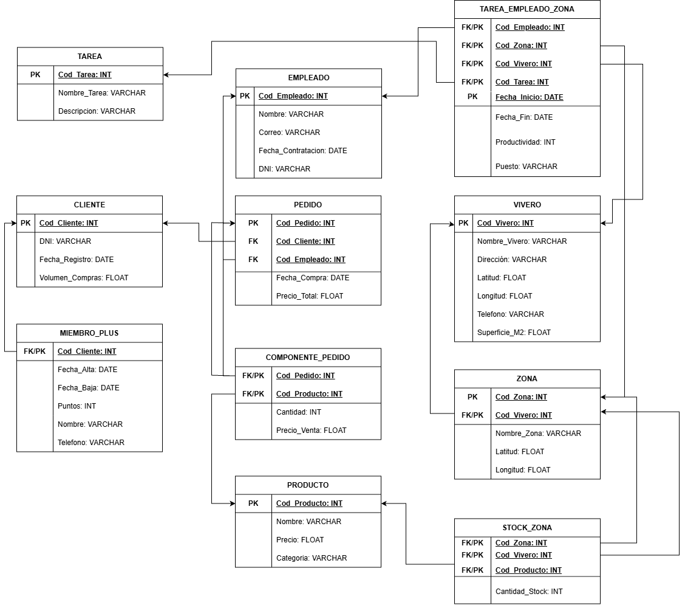

## Descripción del Proyecto

Este repositorio contiene el diseño relacional e implementación física en PostgreSQL para la gestión de la red de viveros **Tajinaste S.A.**. 

El modelo implementa:
- Integridad referencial mediante claves primarias, foráneas y borrados en cascada/restricción.
- Validación de datos mediante restricciones `CHECK` (coordenadas GPS, importes no negativos).
- Atributos derivados automáticos mediante columnas generadas (`STORED`) y **Triggers** para la actualización en tiempo real de importes de pedidos y volumen de compras por cliente.

---

## Despliegue de la Base de Datos

Para ejecutar el script completo de creación de base de datos, usuario, tablas y carga de datos iniciales:

```bash
sudo -u postgres psql -f Script.sql
```

## Consultas SELECT para cada tabla de la base de datos

- SELECT * FROM VIVERO;

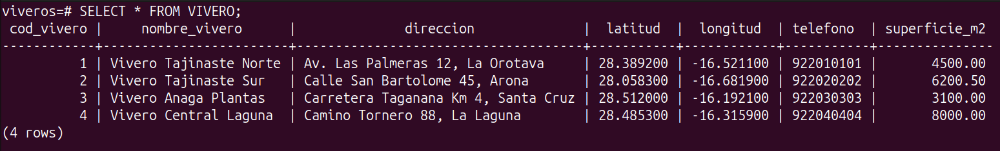

- SELECT * FROM PRODUCTO;

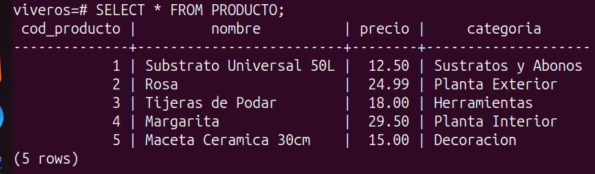

- SELECT * FROM CLIENTE;

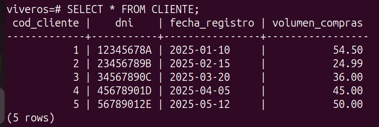

- SELECT * FROM EMPLEADO;

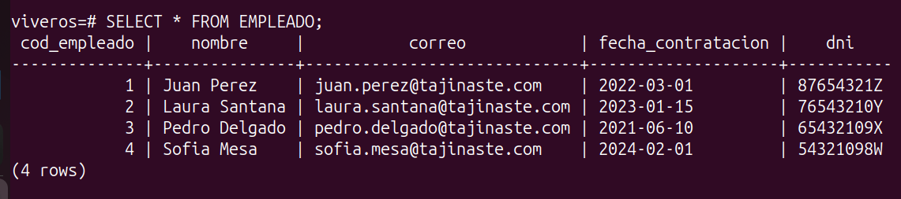

- SELECT * FROM TAREA;

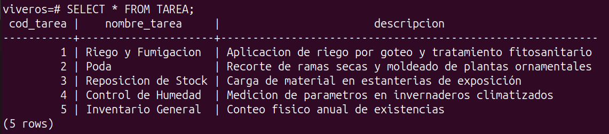

- SELECT * FROM ZONA;

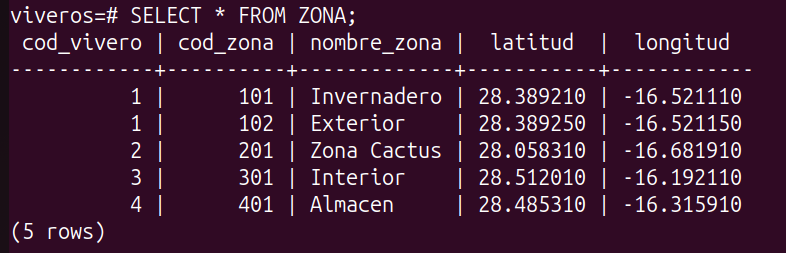

- SELECT * FROM MIEMBRO_PLUS;

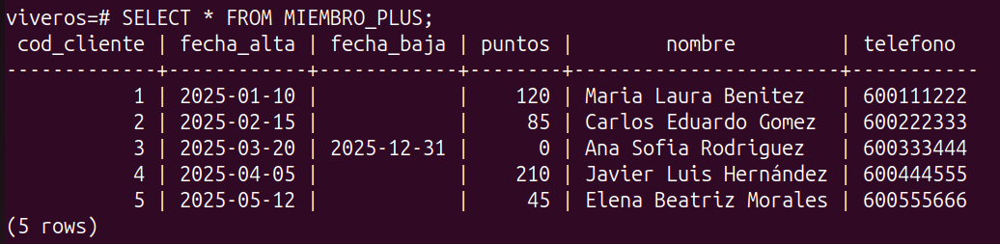

- SELECT * FROM STOCK_ZONA;

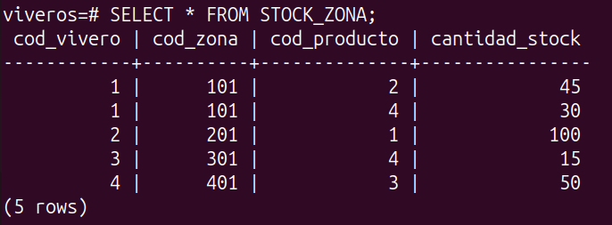

- SELECT * FROM PEDIDO;

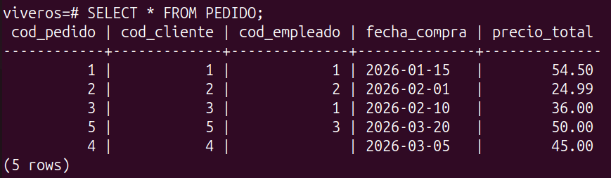

- SELECT * FROM COMPONENTE_PEDIDO;

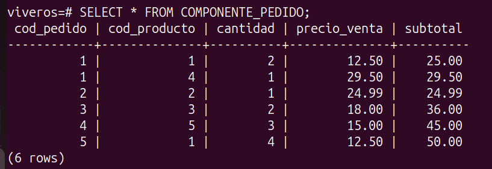

- SELECT * FROM TAREA_EMPLEADO_ZONA;

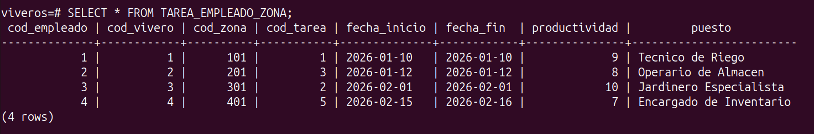
